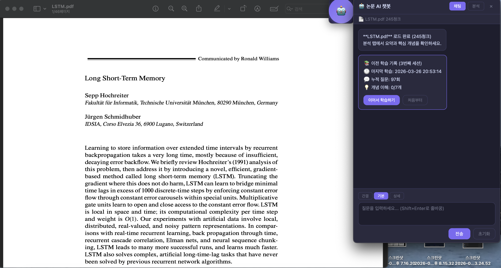
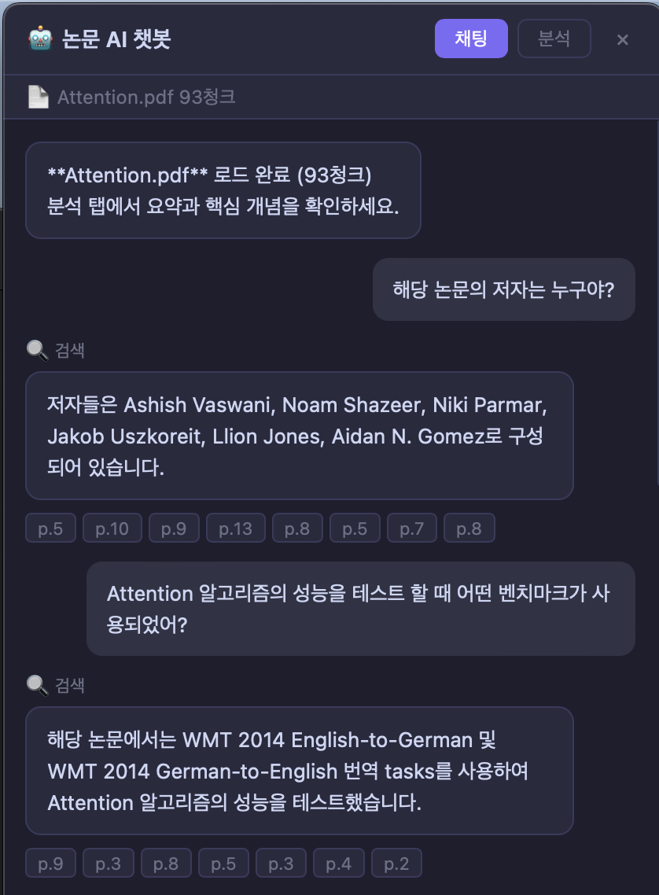
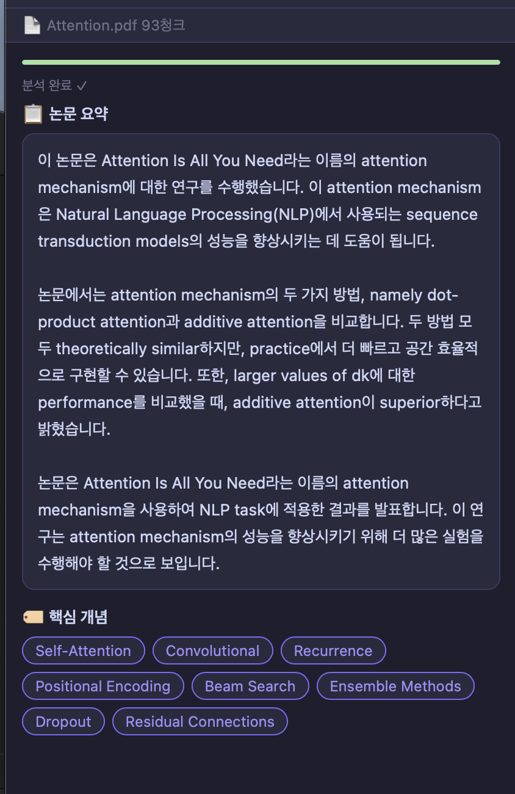
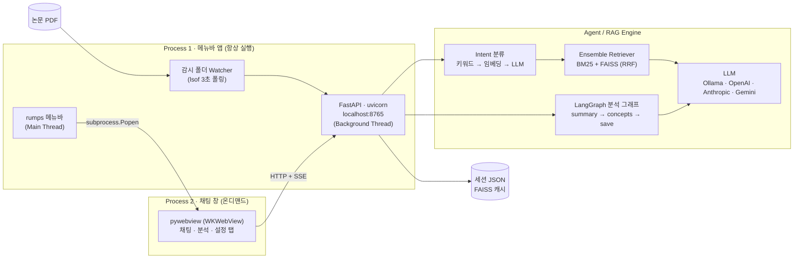

<div align="center">

# 🤖 Paper Agent

**논문 PDF 옆에 항상 떠 있는 macOS AI 학습 도우미**

영어 논문을 열면 챗봇이 자동으로 붙어 요약·핵심 개념을 정리하고,<br>
한국어 질문에 **출처 페이지와 함께** 답합니다. 기본값은 로컬 LLM이라 문서가 밖으로 나가지 않습니다.




</div>

---

## 목차

1. [왜 만들었나](#-왜-만들었나)
2. [주요 기능](#-주요-기능)
3. [아키텍처](#-아키텍처)
4. [엔지니어링 결정과 트러블슈팅](#-엔지니어링-결정과-트러블슈팅)
5. [품질 검증](#-품질-검증)
6. [실행 방법](#-실행-방법)
7. [저장소 구조](#-저장소-구조)
8. [한계와 다음 단계](#-한계와-다음-단계)

---

## 💡 왜 만들었나

| 기존 방식 | Paper Agent |
|---|---|
| 모르는 용어가 나오면 브라우저로 이동해 검색 | 논문 옆 챗봇에 바로 질문 |
| 범용 LLM에 물으면 논문과 무관한 답·환각 | 논문 청크만 근거로 답변 + 출처 페이지 표시 |
| 출처를 확인하려면 PDF를 다시 뒤짐 | 출처 칩 클릭 → 해당 페이지로 이동 |
| 세션이 끝나면 학습 맥락이 사라짐 | 논문별 학습 세션 자동 저장 → 이어서 학습 |
| 사내·민감 문서는 외부 API에 올리기 부담 | 기본값 로컬 LLM(Ollama), 오프라인 동작 |

> "영어 논문 → 한국어 질문 → 한국어 답변"의 **교차 언어(Cross-lingual)** 시나리오를 기본 전제로 설계했습니다.

---

## ✨ 주요 기능

<table>
<tr>
<td width="50%"></td>
<td width="50%"></td>
</tr>
<tr>
<td align="center"><b>💬 채팅</b> — SSE 스트리밍 답변 + 출처 페이지 칩</td>
<td align="center"><b>📋 분석</b> — LangGraph로 요약 → 핵심 개념 추출 → 세션 저장</td>
</tr>
</table>

- **📂 감시 폴더 자동 감지** — 지정 폴더에서 PDF를 열면 `lsof` 폴링으로 감지해 자동 인덱싱
- **🧭 의도 기반 라우팅** — 질문을 `qa / explain / summarize / quiz / confirm / out_of_scope` 6개 의도로 분류해 의도별 프롬프트로 응답
- **🚫 범위 밖 질문 차단** — 논문과 무관한 질문은 생성하지 않고 정중히 거절 (환각 방지)
- **🎚 답변 스타일** — 간결 / 기본 / 상세 선택
- **🔌 멀티 프로바이더** — Ollama(기본) · OpenAI · Anthropic · Google Gemini를 설정 탭에서 전환
- **📚 학습 세션** — 논문 해시별 질문 기록·개념 이해도 저장, "이어서 학습하기"
- **📦 배포** — py2app `.app` → `.dmg`, 태그 푸시 시 GitHub Actions로 자동 빌드

---

## 🏗 아키텍처



**채팅 요청 흐름**

```text
질문 → classify_intent()  ── 1) 키워드 사전 필터       (LLM 호출 없음)
                          ── 2) 임베딩 유사도 분류      (~10ms, 임계값 0.55)
                          ── 3) LLM 폴백               (애매한 케이스만)
     → STREAM_FN_MAP[intent]()
         → BM25 + FAISS 앙상블 검색 (RRF)
         → LLM 토큰 스트리밍 (SSE)
         → sources: [{page, text, pdf_path}]  → 출처 칩 클릭 시 해당 페이지 열기
     → 세션 JSON 저장
```

---

## 🔧 엔지니어링 결정과 트러블슈팅

### 1. 소형 LLM의 환각과 의도 오분류 → 3단계 하이브리드 분류기

**문제** — 로컬 소형 모델(llama3.2:3b)로 QA를 돌리자 두 가지가 터졌습니다.
- 논문과 무관한 "GPT가 뭐야?"에 **약 17,000자**를 생성 (환각)
- 6지선다 단일 프롬프트에서 분류 결과가 `quiz`, `summarize` 쪽으로 쏠림

**시도와 선택**

| 단계 | 방식 | 결과 |
|---|---|---|
| v1 | LLM 단일 프롬프트로 5~6개 의도 분류 | 소형 모델이 특정 옵션으로 편향 |
| v2 | 범위 판단(yes/no) → 의도 분류로 분리 + 키워드 사전 필터 | 범위 밖 질문 차단 성공, 키워드 케이스 6/6, LLM 분류 9/13 |
| **v3** | **키워드 → 다국어 임베딩 코사인 유사도 → LLM 폴백** | 대부분 LLM 호출 없이 분류, 단계별 점수 로그로 원인 추적 가능 |

**배운 점** — 복잡한 판단을 하나의 프롬프트에 몰지 않고, **확실한 건 규칙으로, 애매한 것만 LLM으로** 넘기는 편이 속도·정확도·디버깅 모두에서 유리했습니다.

### 2. macOS 메인 스레드 충돌 → 프로세스 분리

`rumps`(메뉴바)와 `pywebview`(WKWebView)는 둘 다 메인 스레드의 NSRunLoop를 요구해 한 프로세스에서 함께 띄우면 크래시가 났습니다.
→ 메뉴바 + FastAPI 서버(Process 1)와 채팅 창(Process 2)을 분리하고, 두 프로세스는 **HTTP + SSE라는 하나의 인터페이스**로만 통신하도록 설계했습니다.

### 3. 기술 선택 기준: "사용자 환경에서 실제로 돌아가는가"

| 선택 | 대안 | 이유 |
|---|---|---|
| pywebview (WKWebView) | PyQt6 | 번들 약 5MB vs 200MB+, HTML/CSS/JS 그대로 재사용 |
| FastAPI | Flask | `StreamingResponse`로 SSE 기본 지원, Pydantic 타입 안정성 |
| BM25 + FAISS 앙상블 | 벡터 검색 단독 | "표 3의 수치는?" 같은 키워드 질문과 의미 질문을 모두 커버 |
| Ollama 기본 + 멀티 프로바이더 | 클라우드 API 고정 | 무비용·오프라인 요건, 필요 시 상용 API로 전환 |

### 4. 배포 파이프라인

- `py2app`으로 `.app` 번들 → `create-dmg`로 `.dmg` 생성 (`05_pdf_agent/build.sh`)
- `v*` 태그 푸시 시 GitHub Actions(macOS runner)에서 자동 빌드·릴리스
- py2app이 복사한 `liblzma` dylib 서명이 깨져 실행이 막히는 문제 → 빌드 단계에서 dylib 교체 후 재서명
- 상세 과정: [`05_pdf_agent/DEPLOYMENT.md`](05_pdf_agent/DEPLOYMENT.md)

---

## ✅ 품질 검증

"그럴듯해 보인다" 대신 **질문 세트를 먼저 설계하고 돌려본 뒤 고치는** 사이클로 개선했습니다.

| 카테고리 | 질문 수 | 평가 포인트 |
|---|---|---|
| 사실 확인 | 5 | Faithfulness |
| 개념 설명 | 4 | 의도 분류 정확도 |
| 비교·분석 | 3 | 실험 결과 정확성 |
| 요약 | 2 | 구조적 요약 |
| 퀴즈 | 2 | 문제 형식 |
| 경계 케이스 | 3 | 환각 방지 |

- 테스트 계획: [`05_pdf_agent/QA_PLAN.md`](05_pdf_agent/QA_PLAN.md) · 결과: [`05_pdf_agent/agent_QA.json`](05_pdf_agent/agent_QA.json)
- 개발 로그(문제 발견 → 개선 과정): [`05_pdf_agent/agent_logging_0326.md`](05_pdf_agent/agent_logging_0326.md)
- Ragas 정량 평가 스크립트: [`04_mini_project/evaluate.py`](04_mini_project/evaluate.py)

---

## 🚀 실행 방법

**요구 사항**: macOS (Apple Silicon 권장), Python 3.11, [Poetry](https://python-poetry.org/), [Ollama](https://ollama.com/)

```bash
# 1. 의존성 설치
git clone https://github.com/kijae-kim/Paper_Agent.git
cd Paper_Agent
poetry install

# 2. 로컬 LLM 준비 (기본 모델)
ollama pull qwen2.5:7b
ollama serve

# 3. 실행 — 메뉴바에 🤖 아이콘이 나타납니다
poetry run python 05_pdf_agent/menubar_app.py
```

첫 실행 시 온보딩에서 **논문 폴더**와 LLM 프로바이더를 고릅니다. OpenAI·Anthropic·Gemini를 쓰려면 설정 탭에 API 키를 입력하세요.

---

## 📁 저장소 구조

이 저장소는 **2주 RAG 학습 → MVP → 제품화** 과정을 그대로 담고 있습니다.

```text
Paper_Agent/
├── 01_langchain_basics/   # Prompt, ChatModel, LCEL
├── 02_rag_pipeline/       # Loader → Splitter → Embedding → VectorStore
├── 03_retriever_chain/    # 앙상블 검색, 대화 이력 기반 검색
├── 04_mini_project/       # Streamlit RAG 챗봇 MVP + Ragas 평가
└── 05_pdf_agent/          # ⭐ macOS 메뉴바 앱 (본 프로젝트)
    ├── menubar_app.py     #   진입점: rumps + uvicorn + 감시 폴더
    ├── webview_process.py #   채팅 창 (pywebview)
    ├── agent/             #   LangGraph 그래프, intent 분류, LLM 설정
    ├── api/routes/        #   chat · agent · document · session · settings · onboarding
    ├── session/           #   학습 세션 모델·저장
    ├── ui/                #   HTML/CSS/JS (채팅·분석·설정·런처)
    └── build.sh, setup.py #   py2app 빌드 / DMG 패키징
```

| 단계 | 결과물 | 설계 문서 |
|---|---|---|
| 01~03 학습 | 개념별 실습 코드 | [`STUDY_PLAN.md`](STUDY_PLAN.md) |
| 04 MVP | Streamlit 챗봇 | [`04_mini_project/README.md`](04_mini_project/README.md) |
| 05 제품 | macOS 앱 | [`05_pdf_agent/README.md`](05_pdf_agent/README.md) |

---

## 🧭 한계와 다음 단계

- **검색 누락으로 인한 오답** — 관련 청크가 검색되지 않으면 모델이 용어를 지어내는 경우가 있었습니다 (예: CEC). → Reranker 도입, 청크 크기 재조정 예정
- **정량 평가 미달** — Ragas Faithfulness 목표 0.80 대비 초기 측정 0.65 (llama3.2:3b, MVP 기준). 로컬 LLM을 평가자로 쓸 때 점수 산출이 불안정한 문제도 함께 확인 → 현재 모델(qwen2.5:7b)로 재측정 예정
- **배포** — Apple Developer ID 서명·공증 후 정식 배포

---

<div align="center">

**Made by [김기재 (Kijae Kim)](https://github.com/kijae-kim)** · 고객의 말을 엔지니어링으로 번역하는 개발자

</div>
